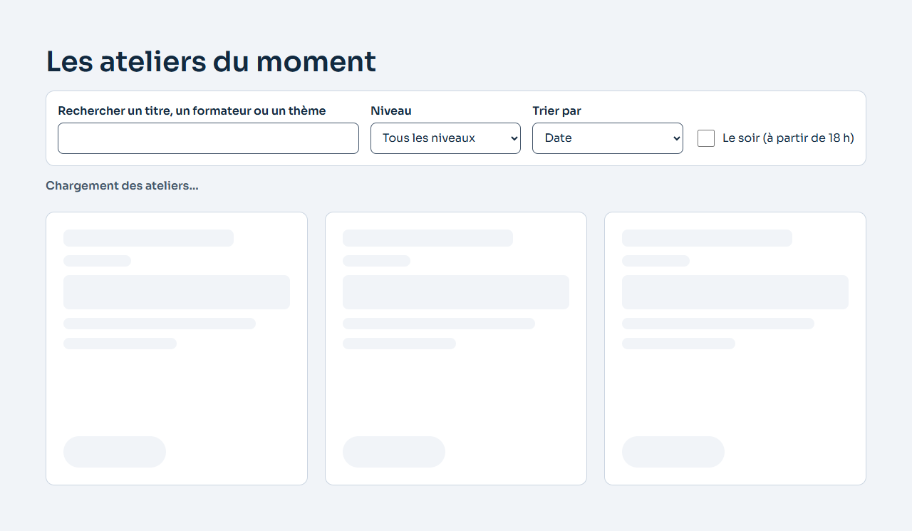
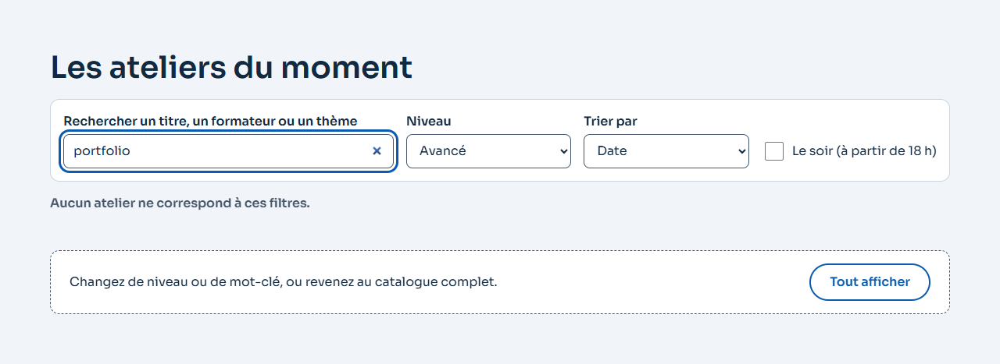
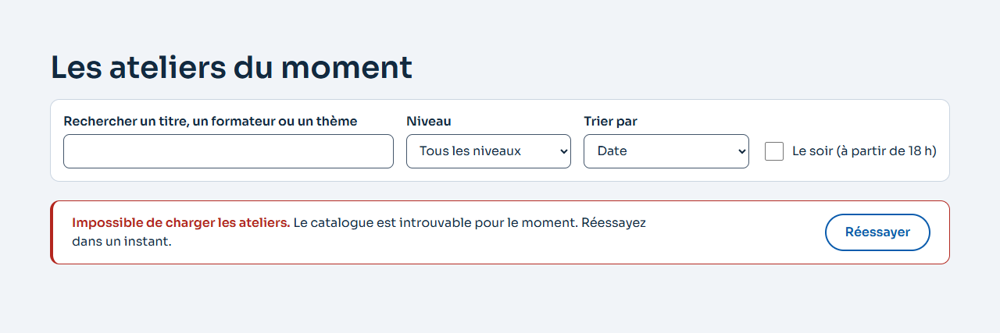
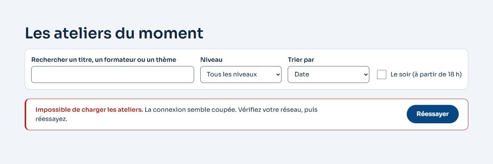
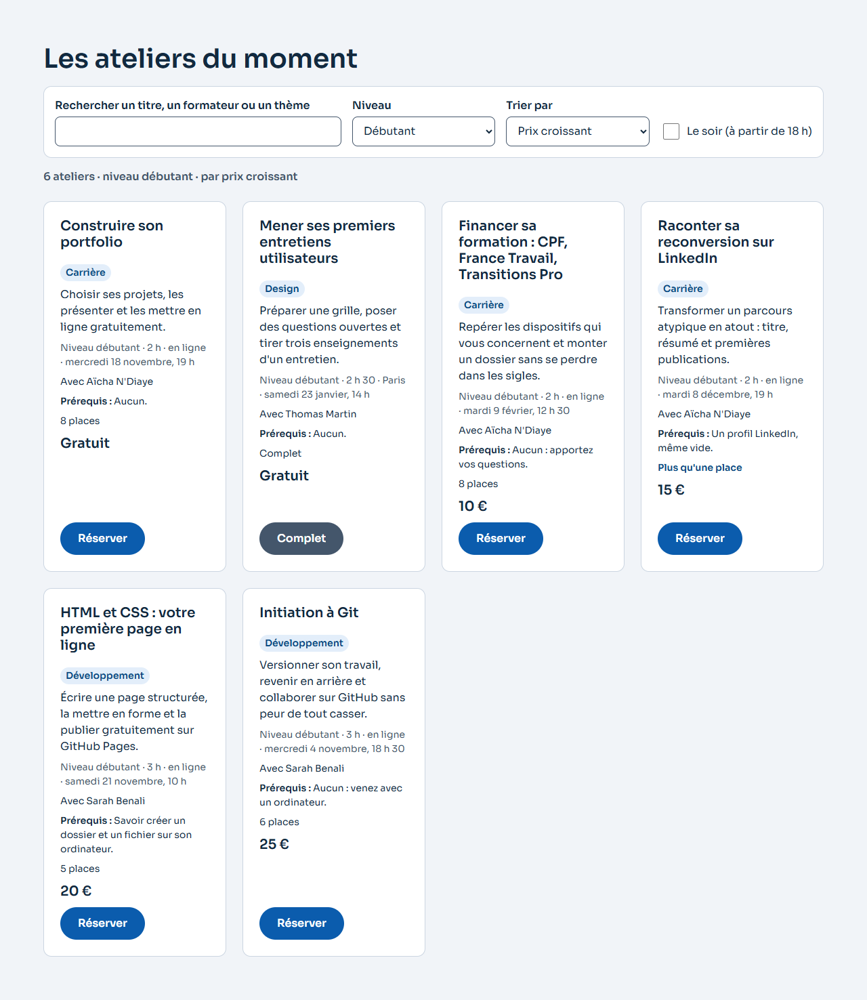

# FM03 · TP 3 — le catalogue d'ateliers, chargé et filtrable

> Consigne (diapo 50) : un `ateliers.json` d'au moins douze ateliers ; `chargerAteliers()` en TypeScript avec `response.ok`, la gestion d'erreur et le signal d'annulation ; le filtre du chapitre 4 (recherche, niveau, tri par prix), un seul état et un seul point d'entrée ; les **quatre états** ; **provoquer les pannes** (hors ligne, 404) sans qu'aucun indicateur ne reste bloqué ; le parcours au clavier, compteur annoncé à chaque changement.
> Critères : C04 et C05, interactions côté client et communication asynchrone.

## 1. Les données : [`src/donnees/ateliers.json`](../src/donnees/ateliers.json)

**14 ateliers** pour une reconversion dans le numérique, animés par les trois formateurs de la page :

| Champ | Exemple | Règle |
|---|---|---|
| `id` | `"git-initiation"` | unique, minuscules et tirets |
| `titre` | `"Initiation à Git"` | deux titres de plus de 70 caractères, pour les cartes |
| `niveau` | `"debutant"` | `debutant`, `intermediaire` ou `avance` (le type `Niveau`) |
| `prix` | `25` | un **nombre** en euros ; `0` = gratuit (deux ateliers) |
| `places` | `6` | places restantes : deux ateliers à `0` (complets), un à `1`, deux à 2 ou 3 |
| `formateur` | `"Sarah Benali"` | un des trois formateurs de la page |
| `categorie`, `description` | `"Développement"`, … | |
| `prerequis` | `"Aucun : venez avec un ordinateur."` | le correctif proposé par l'audit Nielsen du TP 2 de FM02 |
| `duree` | `180` | en minutes, de 2 à 4 heures |
| `lieu` | `"En ligne"` / `"Paris"` | |
| `date` | `"2026-11-04T18:30:00+01:00"` | ISO 8601 **avec le décalage** : l'heure affichée est celle de Paris, quel que soit le fuseau de l'ordinateur |

[`donnees.test.js`](../tests/unitaires/donnees.test.js) vérifie le fichier : au moins douze ateliers, chacun accepté par `estAtelier`, des identifiants uniques et les cas limites présents. Il vérifie aussi que les trois ateliers écrits dans la page pour le cas **sans JavaScript** sont bien dans le catalogue.

## 2. Le chargement typé : [`src/ts/api.ts`](../src/ts/api.ts)

```ts
export async function chargerAteliers(signal?: AbortSignal, { url = URL_ATELIERS, delaiMax = DELAI_MAX } = {}) {
  const arret = new AbortController();                                    // UN signal pour fetch…
  let delaiDepasse = false;
  const minuterie = setTimeout(() => { delaiDepasse = true; arret.abort(); }, delaiMax);   // … qui tombe au bout de 8 s
  const relayer = () => arret.abort(signal?.reason);                      // … ou quand l'appelant annule
  if (signal?.aborted) relayer();
  signal?.addEventListener("abort", relayer, { once: true });
  try {
    const reponse = await fetch(url, { headers: { Accept: "application/json" }, signal: arret.signal });
    if (!reponse.ok) throw new ErreurChargement("http", …, { statut: reponse.status });   // fetch ne rejette PAS sur 404/500
    const donnees: unknown = await reponse.json();
    if (!estListeDAteliers(donnees)) throw new ErreurChargement("format", …);           // le type est une promesse
    return donnees;
  } catch (erreur) {
    if (erreur instanceof ErreurChargement) throw erreur;
    if (signal?.aborted) throw erreur;                    // annulation voulue : l'AbortError passe telle quelle
    if (delaiDepasse) throw new ErreurChargement("delai", …);
    if (erreur instanceof SyntaxError) throw new ErreurChargement("format", …);   // une page HTML servie en 200
    throw new ErreurChargement("reseau", …);              // la seule chose que fetch rejette
  } finally {
    clearTimeout(minuterie);                              // quoi qu'il arrive, la minuterie et l'écouteur partent
    signal?.removeEventListener("abort", relayer);        // la MÊME fonction des deux côtés (cours, 2.4)
  }
}
```

- **`response.ok`** : sans ce test, un 500 deviendrait un catalogue vide (cours, 5.2).
- **Le délai** : un serveur qui ne répond jamais laisserait l'indicateur tourner pour toujours. Au bout de 8 s, la panne devient « délai ». Le signal combiné est écrit à la main avec un `AbortController` plutôt qu'avec `AbortSignal.any` (2024, trop récent pour tous les navigateurs : sans lui, le catalogue resterait en panne pour toujours ; testé en retirant `AbortSignal.any`).
- **L'annulation** : le signal de l'appelant est relayé à `fetch`, et son `AbortError` n'est jamais traitée comme une panne (testé). Dans cette page, une seule requête part à la fois ; le catalogue annulerait la précédente s'il relançait pendant qu'elle vole (une recherche côté serveur, cours 5.6).
- **La forme** : `as Promise<Atelier[]>` ne vérifie rien. `estAtelier(valeur: unknown): valeur is Atelier` contrôle chaque champ, y compris un prix reçu en chaîne (« 25 € »), qui est refusé.
- **Le chemin** : `new URL("../donnees/ateliers.json", import.meta.url)`, c'est-à-dire relatif au module lui-même. Il reste juste quelle que soit l'adresse de la page (en local ou sous `/CDWS-2027-FilRouge/src/` sur GitHub Pages).

Les sorties sont testées une à une avec un faux `fetch` ([`api.test.js`](../tests/unitaires/api.test.js)) : 200, 404, 500, réseau coupé, délai, annulation, HTML au lieu de JSON, objet au lieu de liste, prix en chaîne, chaque champ manquant.

## 3. Le filtre, un seul état : [`src/ts/catalogue.ts`](../src/ts/catalogue.ts)

```ts
type Chargement =
  | { statut: "en-cours" }
  | { statut: "erreur"; erreur: ErreurChargement }
  | { statut: "pret"; ateliers: readonly Atelier[] };
interface EtatCatalogue { chargement: Chargement; criteres: Criteres }   // UN état

function majEtat(changement: Partial<EtatCatalogue>) { etat = { ...etat, ...changement }; rendre(); }   // UN point d'entrée
```

L'état du chargement est une **union** : un catalogue « prêt » a forcément ses ateliers, une « erreur » forcément sa panne. Un état impossible ne s'écrit même pas. L'écran se **déduit** de l'état (`ecranDe`) et `rendre()` le dessine par un `switch`. Une branche oubliée ne compile pas (`const oublie: never = ecran`) : l'écran blanc devient impossible (cours, 5.5).

**Les critères** `{ recherche, niveau, soir, tri }`, appliqués par des fonctions pures ([`filtre.ts`](../src/ts/filtre.ts), testées sous Node) :

- **recherche** dans le titre, le formateur et le thème, sans accents ni majuscules (« accessibilite » trouve « Accessibilité »), mot par mot (« sarah git ») ;
- **niveau** par un `<select>`, **tri** par date, prix croissant ou décroissant (à prix égal, le plus proche d'abord). `filter` rend un nouveau tableau, donc `sort` ne réordonne jamais le catalogue d'origine (testé) ;
- **le soir** : un atelier qui commence à 18 h ou après, **heure de Paris**. C'est le besoin de Mélanie (persona de FM02).

**Écouteurs délégués**, sur le formulaire des filtres (`input`, `change`, `submit`) et sur la section (un seul `click` pour les boutons « Réserver » de toutes les cartes, « Réessayer » et « Tout afficher »).

**Anti-rebond** ([`attendre-la-fin.ts`](../src/ts/attendre-la-fin.ts), 300 ms, cours 5.6). Le JSON est chargé une fois et le filtre est local : rien ne part au serveur à chaque lettre. Ce que l'anti-rebond économise ici, c'est le rendu et **l'annonce** à chaque frappe, sans quoi le lecteur d'écran lirait « 14 ateliers, 9 ateliers, 3 ateliers… » pendant qu'on tape. Mesuré : taper « accessibilite » donne **une** annonce, pas treize (test). Entrée applique tout de suite.

**Le compteur nomme les critères** : « 2 ateliers · « sarah » · niveau débutant · par prix croissant ». Une zone `role="status"` n'annonce qu'un texte qui **change**. Avec un simple « 12 ateliers », changer le tri ne changerait rien au texte et ne serait jamais annoncé. Ici, chaque changement change le texte.

**Les raccourcis** du sous-menu (TP 1) passent par la frontière du composant : `appliquerRaccourci("debutant")`.

## 4. Les quatre états

| État | À l'écran | Annonce | Focus |
|---|---|---|---|
| **Chargement** | trois cartes fantômes à la taille des vraies (place réservée : rien ne saute à l'arrivée), `aria-busy="true"` sur la liste, cartes `aria-hidden` | « Chargement des ateliers… », polie (`role="status"`) | inchangé |
| **Vide** | « Aucun atelier ne correspond à ces filtres. », un conseil et « Tout afficher » | polie : un résultat vide n'est **pas** une panne | « Tout afficher » → le champ de recherche |
| **Erreur** | une phrase selon la panne et « Réessayer » ; le code HTTP part **dans la console**, jamais à l'écran | `role="alert"`, inséré à neuf à chaque panne : il interrompt | « Réessayer » disparaît → le titre de la section (`tabindex="-1"`) |
| **Succès** | les cartes (prérequis, places, « Plus que 2 places », « Complet ») | le compteur, qui nomme les critères | inchangé |

| Panne | Phrase affichée (après « Impossible de charger les ateliers. ») |
|---|---|
| hors ligne | La connexion semble coupée. Vérifiez votre réseau, puis réessayez. |
| 404 | Le catalogue est introuvable pour le moment. Réessayez dans un instant. |
| 500 et plus | Le serveur rencontre un problème. Réessayez dans un instant. |
| délai dépassé | Le serveur met trop de temps à répondre. Réessayez dans un instant. |
| réponse illisible | Les données reçues sont illisibles. Réessayez dans un instant ; si cela continue, revenez plus tard. |

**Les captures** ([`captures/fm03/`](captures/fm03/), produites par `npm run captures`, à 1280 et 375 px) :

| Chargement | Vide | Erreur 404 | Erreur hors ligne | Succès |
|---|---|---|---|---|
|  |  |  |  |  |

axe-core (le moteur de Lighthouse Accessibilité) ne relève **aucune violation WCAG 2.2 A/AA** dans chacun des quatre états, ni fiche ouverte, ni menu ouvert ([`axe.test.js`](../tests/e2e/axe.test.js)).

## 5. Les pannes, provoquées

| Panne | Comment | Résultat |
|---|---|---|
| **Hors ligne** | `page.setOfflineMode(true)`, l'équivalent de la case *Offline* de l'onglet Réseau, puis « Réessayer » | la phrase « connexion coupée », `aria-busy="false"`, aucune carte fantôme restante ; réseau rendu, « Réessayer » ramène les 14 ateliers |
| **404** | le serveur de test répond 404 pour `ateliers.json`, comme si le fichier était renommé | la phrase « introuvable », le code dans la console (`catalogue non chargé (http 404)`), rien de bloqué ; « Réessayer » → focus sur le titre, puis succès |
| **500** | idem, code 500 | « le serveur rencontre un problème » |
| **Lenteur** | réponse retenue 1,5 s | les cartes fantômes et « Chargement… », puis le succès |
| **Silence** | (test unitaire) un serveur qui ne répond jamais | panne « délai » au bout du délai maximal, jamais un indicateur éternel |

Tout est rejoué par [`catalogue.test.js`](../tests/e2e/catalogue.test.js). **À la main**, pour la démonstration :

1. `npm run servir`, puis http://localhost:8000.
2. **404** : renommer `src/donnees/ateliers.json` en `ateliers.bak.json`, recharger la page : l'erreur « introuvable » et son bouton « Réessayer ».
3. **Hors ligne** : laisser l'erreur affichée, remettre le nom du fichier, puis F12 → Réseau → cocher *Offline* → « Réessayer » : l'erreur « connexion coupée », aucun indicateur resté (`aria-busy="false"`, plus de carte fantôme).
4. Décocher *Offline* → « Réessayer » : les 14 ateliers.

(« Réessayer » n'existe que dans l'état d'erreur : c'est pourquoi la panne réseau se provoque à partir d'une première erreur.)

## 6. Le parcours au clavier : filtrer, trier, ouvrir une fiche, revenir

Relevé par [`clavier.test.js`](../tests/e2e/clavier.test.js), à 1280 px. Les annonces sont le texte de la zone `role="status"` à chaque étape :

```
Enter      → (« Voir les ateliers ») point de départ sur la section
Tab        → input#recherche          saisie « sarah »   → « 5 ateliers · « sarah » · par date »
Tab        → select#niveau            ↓ Débutant         → « 2 ateliers · « sarah » · niveau débutant · par date »
Tab        → select#tri               ↓ Prix croissant   → « 2 ateliers · « sarah » · niveau débutant · par prix croissant »
Tab        → input#soir               Espace             → « 1 atelier · « sarah » · niveau débutant · le soir · par prix croissant »
                                      Espace             → « 2 ateliers · « sarah » · niveau débutant · par prix croissant »
Tab        → button "Réserver l'atelier HTML et CSS : votre première page en ligne"
Enter      → input#r-nom              (la fiche : formateur, prérequis, places)
Escape     → button "Réserver l'atelier HTML et CSS : votre première page en ligne"   (revenu sur la carte)
```

Chaque annonce diffère de la précédente : le compteur est annoncé **à chaque changement**.

## 7. La fiche, et ce qu'une réservation change

« Réserver » ouvre la fiche dans le `<dialog>`. Elle affiche le récapitulatif, la description, le formateur, les **prérequis** et les places, puis le formulaire. Une réservation retire une place à l'état du catalogue (`{ ...atelier, places: places - 1 }` : un nouvel objet, l'ancien n'est pas touché) et la carte suit. À zéro, la carte passe à « Complet » et son bouton est inerte. Le focus revient alors sur son titre, puisqu'un bouton désactivé ne peut pas le recevoir. La confirmation dépend du lieu : « le lien de connexion » en ligne, « l'adresse exacte, à Paris » sinon. Le serveur simulé refuse une seconde réservation avec la même adresse.

## 8. Limites assumées

- **Pas de vrai serveur** : GitHub Pages ne sert que des fichiers. Le catalogue est un vrai `fetch` d'un vrai fichier, mais les réservations passent par `serveur-simule.ts` (mêmes délais, mêmes refus) et ne survivent pas au rechargement.
- **Recherche locale** : le JSON est chargé une fois. Annuler la requête en vol à chaque frappe (cours, 5.6) n'a donc pas lieu d'être ici : une seule requête part à la fois. Le mécanisme d'annulation sert au délai maximal, et le signal de l'appelant est accepté et testé pour le jour où une recherche côté serveur relancerait des requêtes.

---

*Fait avec un assistant de code : les données, le code, les tests, les captures et ce rapport. Les pannes ont été réellement provoquées (serveur de test, mode hors ligne du navigateur), et les captures en sont tirées. **À faire moi-même** : refaire les trois manipulations du § 5 dans les outils de développement, et le parcours du § 6 au clavier, avant l'oral.*
